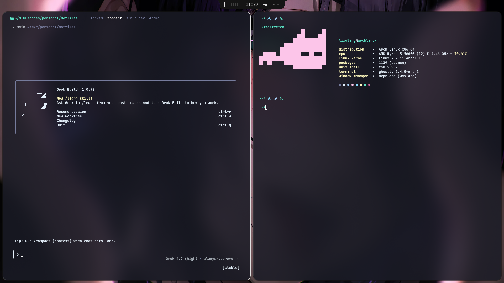

# luxuling/dotfiles

Arch Linux and Hyprland, in a monochrome GrokNight look. The bar is a [Quickshell](https://quickshell.org/) notch. Claude Code and Grok Build show their sessions there.

[](./LICENSE)
[](https://archlinux.org/)
[](https://hyprland.org/)
[](https://github.com/luxuling/dotfiles/stargazers)



## Stack

Configs live in `packages/`. Each folder is a [GNU Stow](https://www.gnu.org/software/stow/) package.

| Package | What it is |
|---|---|
| `hypr` | [Hyprland](https://hyprland.org/) (Lua config), hyprpaper, [hyprlock](https://github.com/hyprwm/hyprlock) |
| `quickshell` | Notch: notifications, launcher, project picker, settings drawer, reminders, media, coding agents |
| `ghostty` | [Ghostty](https://ghostty.org/) with blur and shaders |
| `zsh`, `starship` | Zsh and the [Starship](https://starship.rs/) prompt |
| `tmux` | [tmux](https://github.com/tmux/tmux), no plugins |
| `nvim` | [Neovim](https://neovim.io/) |
| `wallpapers` | Files in `~/.local/share/wallpapers` |
| `scripts` | `coding` (one tmux session per project) and `mf-recording.sh` |
| `gtk` | Orchis-Grey, retrosmart cursor |
| `helium` | [Helium](https://helium.computer/) browser flags |
| `git` | Git config and a global ignore |
| `fastfetch` | [fastfetch](https://github.com/fastfetch-cli/fastfetch) |

The font is [Maple Mono NF CN](https://github.com/subframe7536/maple-font).

## Keys

The modifier is ALT.

| Key | Action |
|---|---|
| ALT+Return | Ghostty |
| ALT+E | Thunar |
| ALT+Q | Close the window |
| ALT+Space | App launcher |
| ALT+T | Project picker |
| ALT+W | Wallpaper picker |
| ALT+Shift+L | Lock |
| ALT+Ctrl+R | Screen recording |
| Print | Region screenshot |
| ALT+Shift+R | Reload the notch and hyprpaper |

Hyprland starts the notch with `qs -c notch`.

## Install

You need `git` and `stow` (`pacman -S git stow`). [`install`](./install) links `packages/` into your home directory.

On a fresh machine, this clones the repo to `~/dotfiles` and links it:

```bash
curl -fsSL https://raw.githubusercontent.com/luxuling/dotfiles/main/install | sh
```

Set `DOTFILES` to clone somewhere else:

```bash
curl -fsSL https://raw.githubusercontent.com/luxuling/dotfiles/main/install | DOTFILES=~/code/dotfiles sh
```

To read the script before it runs, clone first. The directory can have any path and any name:

```bash
git clone https://github.com/luxuling/dotfiles.git /path/to/dotfiles
sh /path/to/dotfiles/install
```

From inside that directory, `./install` does the same thing.

Running `install` again does not clone a second copy and does not pull. After you move the checkout, run it from the new path and it relinks home to that location. It will not replace a real file. When Orchis-Grey is already installed, it also points `~/.config/gtk-4.0/assets` at that theme.

To pick up new commits, pull, then link again. Use your own clone path if it is not `~/dotfiles`:

```bash
git -C ~/dotfiles pull
sh ~/dotfiles/install
```

### Not in the repo

- Zsh plugins, cloned to `~/.zsh/zsh-autosuggestions` and `~/.zsh/zsh-syntax-highlighting`
- Orchis-Grey, and the retrosmart cursor in `~/.local/share/icons`
- Notch tools: `mpg123`, `pw-play`, `cava`, `hyprpicker`, `hyprshot`, `curl`
- Secrets in `~/.secrets.zsh`, which is git-ignored

### Wallpapers

Drop a file in `packages/wallpapers/.local/share/wallpapers/`. It shows up in the picker right away, because `~/.local/share/wallpapers` links to that folder. hyprpaper and hyprlock read `~/.config/hypr/wallpaper.jpg`, and the picker repoints that link. A first install points it at `default.jpg`. `personal.jpg` in that folder is git-ignored.

## Coding agents

The notch shows Claude Code and Grok Build sessions. It handles permission prompts, questions, and plan approval, and it plays a chime when an agent finishes. Both agents call `~/.config/quickshell/notch/agent-hook`. Put this in `~/.claude/settings.json`. Grok reads the same file.

```json
"hooks": {
  "SessionStart": [{ "hooks": [{ "type": "command", "command": "~/.config/quickshell/notch/agent-hook", "timeout": 5 }] }],
  "UserPromptSubmit": [{ "hooks": [{ "type": "command", "command": "~/.config/quickshell/notch/agent-hook", "timeout": 5 }] }],
  "Stop": [{ "hooks": [{ "type": "command", "command": "~/.config/quickshell/notch/agent-hook", "timeout": 5 }] }],
  "Notification": [{ "hooks": [{ "type": "command", "command": "~/.config/quickshell/notch/agent-hook", "timeout": 5 }] }],
  "SessionEnd": [{ "hooks": [{ "type": "command", "command": "~/.config/quickshell/notch/agent-hook", "timeout": 5 }] }],
  "PostToolUse": [{ "matcher": "*", "hooks": [{ "type": "command", "command": "~/.config/quickshell/notch/agent-hook", "timeout": 5 }] }],
  "PostToolUseFailure": [{ "matcher": "*", "hooks": [{ "type": "command", "command": "~/.config/quickshell/notch/agent-hook", "timeout": 5 }] }],
  "PermissionRequest": [{ "matcher": "*", "hooks": [{ "type": "command", "command": "~/.config/quickshell/notch/agent-hook", "timeout": 3600 }] }],
  "PreToolUse": [{ "matcher": "AskUserQuestion|ask_user_question|ExitPlanMode", "hooks": [{ "type": "command", "command": "~/.config/quickshell/notch/agent-hook", "timeout": 3600 }] }]
}
```

Grok reports cancelled and failed turns with its own events, so `~/.grok/hooks/notch.json` adds them:

```json
{
  "hooks": {
    "StopCancelled": [{ "hooks": [{ "type": "command", "command": "~/.config/quickshell/notch/agent-hook", "timeout": 5 }] }],
    "StopFailure": [{ "hooks": [{ "type": "command", "command": "~/.config/quickshell/notch/agent-hook", "timeout": 5 }] }]
  }
}
```

The agent list also shows usage limits:

- Claude: claude-hud writes its rate limits once `~/.claude/plugins/claude-hud/config.json` has `{ "display": { "externalUsageWritePath": "~/.cache/claude-usage.json" } }`. Use the absolute path.
- Grok: weekly credit use comes from the last billing line in `~/.grok/logs/unified.jsonl`.

## License

MIT. See [LICENSE](./LICENSE).
