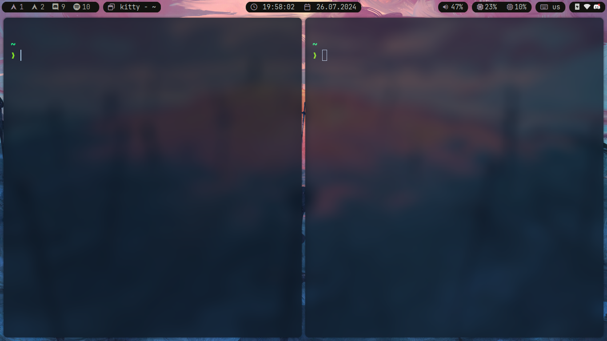

# My Personal Dotfiles
My Arch Linux + Hyprland setup: a monochrome GrokNight look, one quickshell notch instead of a bar, and coding agents wired into it.

## Screenshot



## What I use
| Package | Tool |
|---|---|
| `hypr` | [Hyprland](https://hyprland.org/) (Lua config), hyprpaper, [hyprlock](https://github.com/hyprwm/hyprlock), wallpaper |
| `quickshell` | [Quickshell](https://quickshell.org/) notch: bar, notifications, app launcher (ALT+SPACE), project picker (ALT+T), reminders, media, coding agents |
| `ghostty` | [Ghostty](https://ghostty.org/) terminal with blur and shaders |
| `zshrc`, `starship` | Zsh with [Starship](https://starship.rs/) prompt |
| `tmux` | [Tmux](https://github.com/tmux/tmux) (no plugins) |
| `nvim` | [NeoVim](https://neovim.io/) |
| `scripts` | `coding` (tmux session per project) and `mf-recording.sh` (screen recording) |
| `gtk` | GTK Orchis-Grey theme, retrosmart cursor |
| `helium` | [Helium](https://helium.computer/) browser flags |
| `git` | Git config and global ignore |
| `fastfetch` | [fastfetch](https://github.com/fastfetch-cli/fastfetch) |
| `pi` | [pi](https://github.com/earendil-works/pi) coding agent (`~/.pi/agent`) |

Font: [Maple Mono NF CN](https://github.com/subframe7536/maple-font). Coding agents: Claude Code and Grok Build, both shown in the notch.

## How to use
Configs live in `packages/`. [`install`](./install) links them into your home directory with [GNU Stow](https://www.gnu.org/software/stow/). The clone can sit in any directory. This is the path I use:

```bash
git clone git@github.com:luxuling/dotfiles.git ~/MINE/codes/personal/dotfiles
cd ~/MINE/codes/personal/dotfiles
./install
```

`./install` is safe to run again. After you move the checkout, run it from the new directory and it relinks home to that location. It will not overwrite a real file. When the Orchis-Grey theme is installed, it also points `~/.config/gtk-4.0/assets` at that theme.

Not in the repo, install them yourself:
- zsh plugins cloned to `~/.zsh/zsh-autosuggestions` and `~/.zsh/zsh-syntax-highlighting`
- Orchis-Grey GTK theme and the retrosmart cursor (`~/.local/share/icons`)
- notch runtime tools: `mpg123`, `pw-play`, `cava`, `hyprpicker`, `hyprshot`, `curl`
- secrets go in `~/.secrets.zsh`, which is git-ignored
- the wallpaper. hyprpaper and hyprlock both read `~/.config/hypr/wallpaper.jpg`, and that file is git-ignored

The notch starts from Hyprland as `qs -c notch`. Reload it with ALT+SHIFT+R.

## Coding agents in the notch
The notch shows Claude Code and Grok Build sessions. It handles permission prompts, questions and plan approval, and plays a chime when an agent finishes. Agents reach it through `~/.config/quickshell/notch/agent-hook`, wired into `~/.claude/settings.json` (Grok reads the same file):

```json
"hooks": {
  "SessionStart": [{ "hooks": [{ "type": "command", "command": "~/.config/quickshell/notch/agent-hook", "timeout": 5 }] }],
  "UserPromptSubmit": [{ "hooks": [{ "type": "command", "command": "~/.config/quickshell/notch/agent-hook", "timeout": 5 }] }],
  "Stop": [{ "hooks": [{ "type": "command", "command": "~/.config/quickshell/notch/agent-hook", "timeout": 5 }] }],
  "Notification": [{ "hooks": [{ "type": "command", "command": "~/.config/quickshell/notch/agent-hook", "timeout": 5 }] }],
  "SessionEnd": [{ "hooks": [{ "type": "command", "command": "~/.config/quickshell/notch/agent-hook", "timeout": 5 }] }],
  "PostToolUse": [{ "matcher": "*", "hooks": [{ "type": "command", "command": "~/.config/quickshell/notch/agent-hook", "timeout": 5 }] }],
  "PostToolUseFailure": [{ "matcher": "*", "hooks": [{ "type": "command", "command": "~/.config/quickshell/notch/agent-hook", "timeout": 5 }] }],
  "PermissionRequest": [{ "matcher": "*", "hooks": [{ "type": "command", "command": "~/.config/quickshell/notch/agent-hook", "timeout": 3600 }] }],
  "PreToolUse": [{ "matcher": "AskUserQuestion|ask_user_question|ExitPlanMode", "hooks": [{ "type": "command", "command": "~/.config/quickshell/notch/agent-hook", "timeout": 3600 }] }]
}
```

Grok reports cancelled and failed turns with its own events, so `~/.grok/hooks/notch.json` adds them:

```json
{
  "hooks": {
    "StopCancelled": [{ "hooks": [{ "type": "command", "command": "~/.config/quickshell/notch/agent-hook", "timeout": 5 }] }],
    "StopFailure": [{ "hooks": [{ "type": "command", "command": "~/.config/quickshell/notch/agent-hook", "timeout": 5 }] }]
  }
}
```

The agent list also shows usage limits:
- **Claude:** the claude-hud statusline mirrors its rate limits to a file once `~/.claude/plugins/claude-hud/config.json` has `{ "display": { "externalUsageWritePath": "~/.cache/claude-usage.json" } }` (use the absolute path).
- **Grok:** weekly credit use is read from the last billing line in `~/.grok/logs/unified.jsonl`.

## License
This repository is licensed under the MIT License. See the [LICENSE](./LICENSE) file for more details.
